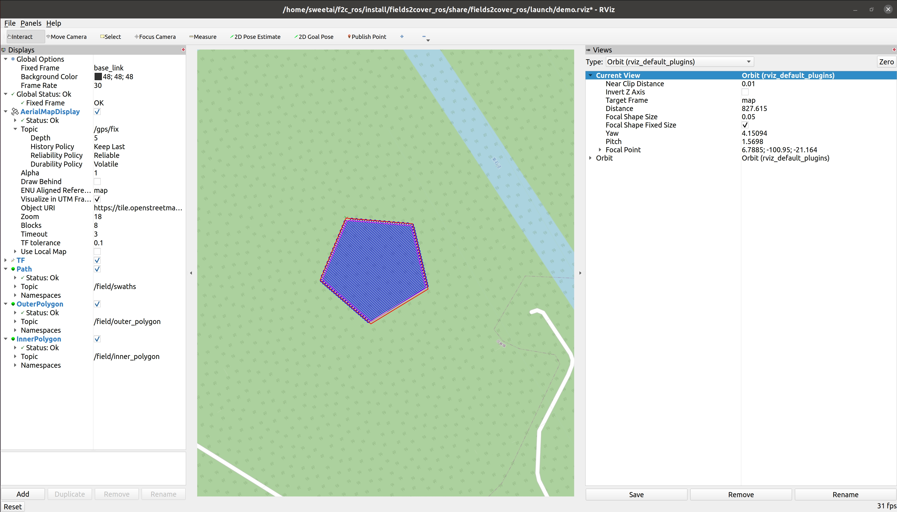

# Fields2Cover ROS2 RViz Visualizer

This programme uses [Fields2Cover](https://github.com/Fields2Cover/Fields2Cover) to solve and visualize the field coverage problem


## 1. environment

- Ubuntu 20.04
- ROS2 Foxy
- C++17
- RViz2
- Fields2Cover

If use other ubunut and ROS2 version ，please check or adapt the CmakeList.txt and F2CUtils.cmake's ubunut version or other settings.

---

## 2. install rviz_satellite 

This programme display map by `rviz_satellite`.if there is no satellite module, install as below：
```bash
ros2 run fields2cover_ros visualizer_node
cd ~/_ws/src
git clone https://github.com/nobleo/rviz_satellite.git
cd ~/_ws
rosdep install --from-paths src --ignore-src -r -y
colcon build --symlink-install --packages-select rviz_satellite
```
---
## 3. run
```bash
source /opt/ros/foxy/setup.zsh
source install/setup.zsh
ros2 run fields2cover_ros visualizer_node
```
## 4. rviz2 visualization
```bash
source install/setup.zsh
ros2 launch fields2cover_ros view_field.launch
```
